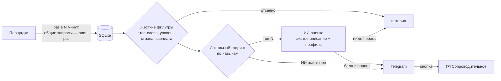

# job-spy-bot

[](https://github.com/luxsordel/job-spy-bot/actions/workflows/ci.yml)

Telegram-бот, который следит за вакансиями на площадках **Беларуси, России, Казахстана, Грузии
и Польши**, бесплатно отсеивает неподходящие и присылает остальные с кратким ИИ-анализом:
насколько вакансия подходит под резюме и нет ли ограничений для граждан РБ.

- 🪶 **Лёгкий**: ~50 МБ RAM, две зависимости (`httpx`, `selectolax`), SQLite.
- 👥 **Многопользовательский**: у каждого свои запросы, фильтры, резюме. Доступ по инвайтам.
- 🤖 **ИИ без перерасхода**: в модель попадают только вакансии, прошедшие бесплатный отсев.
  Есть кэш и дневной лимит токенов.
- 📄 **Несколько резюме**: до 10 PDF под разные направления (Python, C++, QA…). Под каждую
  вакансию ИИ выбирает резюме с наибольшим шансом на оффер, кнопка «Отклик» присылает этот
  PDF и сопроводительное письмо под него.
- 🔌 **Любой OpenAI-совместимый API**: OpenAI, DeepSeek, OpenRouter, Ollama…

## Площадки

| | Площадка | Способ | Нужен ключ |
|---|---|---|---|
| 🇧🇾 | rabota.by | HTML HeadHunter | — |
| 🇧🇾 | praca.by | HTML | — |
| 🇷🇺 | hh.ru | HTML HeadHunter | — |
| 🇷🇺 | Habr Карьера | JSON | — |
| 🇷🇺 | GetMatch | JSON | — |
| 🇷🇺 | SuperJob | API | `SUPERJOB_API_KEY` |
| 🇰🇿 | hh.kz | HTML HeadHunter | — |
| 🇬🇪 | jobs.ge | HTML | — |
| 🇵🇱 | justjoin.it | JSON | — |
| 🇵🇱 | No Fluff Jobs | JSON | — |

Площадки без ключа просто пропускаются. Проверить, что работает:
`python -m jobspybot check-sources "python developer"`.

> **HeadHunter**: официальный API без зарегистрированного приложения отвечает `403`, поэтому бот
> читает обычные страницы поиска и вакансий (данные встроены в них как JSON). Ключ не нужен.

## Как это работает



### Экономия токенов

1. Фильтры и дедупликация бесплатны. На живых данных из 719 вакансий отсев прошли 45.
2. Локальный скоринг по навыкам выбирает лучших. В ИИ уходит не больше `AI_MAX_PER_CYCLE` за цикл.
3. Резюме один раз сжимается в профиль примерно на 150 токенов.
4. Из описания вырезаются блоки «о компании» и «мы предлагаем», дубли и эмодзи, затем текст
   обрезается. Строки про релокацию, визы и удалёнку сохраняются всегда.
5. Ответ модели — короткий JSON, `max_tokens=250`.
6. Кэш (вакансия × профиль) и дневной лимит `AI_DAILY_TOKENS_PER_USER`.
   Общий бюджет на весь бот — `AI_DAILY_TOKENS_TOTAL`: последние `AI_PRO_RESERVE_PCT` %
   достаются только Pro, при исчерпании ИИ ждёт полуночи UTC, админу приходит оповещение.
   Если основная модель не отвечает — запрос повторяется на `AI_FALLBACK_MODEL`.
   Перед платным провайдером можно поставить бесплатные (Groq, Cerebras, OpenRouter,
   Mistral, Gemini): достаточно ключа `AI_<ИМЯ>_KEY`. Бот опрашивает их по порядку
   `AI_FREE_ORDER`, упёршийся в лимит откладывает и переходит к следующему, платный —
   последняя страховка. Состояние цепочки — `ai_providers` в `GET /api/status`.
7. Сопроводительное письмо пишется только по кнопке.
8. Несколько резюме сравниваются одним запросом. Бесплатный предотбор оставляет не больше
   3 самых близких к вакансии. Телефон и email вырезаются из резюме до отправки в модель.

В среднем 1–1,5 тыс. токенов на вакансию.

## Тарифы и подписка

Бот готов к продаже по подписке, оплата **Telegram Stars**. Юрлицо и эквайринг не нужны,
оплата в 2 клика, автопродление каждые 30 дней. Звёзды выводятся через Fragment.

| | Free | Pro |
|---|---|---|
| Направлений поиска | 1 | 10 |
| Резюме | 1 | 10 |
| Вакансий в день | 5 | без лимита |
| ИИ-оценка | ≈3 в день | все вакансии |
| Отклик: лучшее резюме + письмо | — | ✓ |
| Проверка площадок | раз в 3 ч | раз в 30 мин |

Настройки в `.env`:
- `ACCESS_MODE=invite|open`. `invite` — только по приглашениям; `open` — любой по /start
  получает пробный Pro, затем Free.
- `TRIAL_DAYS=7` — пробный период.
- `PRO_PRICE_STARS=250` — цена за 30 дней; `0` выключает оплату (Pro выдаёт только админ).
- `SUPPORT_CONTACT=@username` — контакт на странице подписки.

Лимиты тарифов задаются в `src/jobspybot/billing.py`. Администраторы всегда на Pro.

Админ-команды: `/admin` (пользователи, платящие, выручка), `/invite`, `/users`,
`/grant ID ДНЕЙ`, `/refund ID`.

## Интерфейс

- **Профиль из резюме.** Человек присылает PDF, ИИ достаёт роль, уровень, опыт, навыки,
  языки, город, формат работы, релокацию, зарплату и направления поиска. Бот задаёт кнопками
  только недостающие вопросы и сам настраивает анкету поиска. Без резюме те же вопросы
  проходятся вручную.
- **Формат и город.** Удалёнка, гибрид или офис берутся из данных площадок (hh, GetMatch,
  justjoin, No Fluff Jobs, SuperJob). Есть переключатели «офис и гибрид только в моём городе»
  и «скрывать вакансии без формата».
- **📝 Пожелания** свободным текстом (район, метро, график). ИИ сверяет их с адресом вакансии:
  rabota.by и hh отдают улицу и метро, они видны в карточке.
- **✍️ Изменить словами.** Можно просто написать «хочу только гибрид во Фрунзенском районе,
  от 1000$». ИИ разбирает фразу в правки, бот показывает «Понял так: …» и ждёт подтверждения.
- **👤 Профиль**: всё видно и правится кнопками, поиск перестраивается сам. ИИ учитывает
  профиль (гражданство, релокация, формат, ожидания) при оценке вакансий и в письмах.
- **Главное меню** под полем ввода: 🔎 Мой поиск · 👤 Профиль · 📄 Резюме · ⚙️ Фильтры ·
  💎 Подписка · ❓ Помощь.
- **Фильтры кнопками**, без команд. Текстовые команды тоже работают.
- **🔔 Когда присылать** (⚙️ Фильтры): сразу или раз в день дайджестом — 10 лучших
  вакансий одним сообщением в выбранный час; тихие часы 23:00–08:00 — ночью вакансии копятся
  и приходят утром. Часовой пояс — по стране проживания или выбирается вручную.
- Описание бота в профиле Telegram задаётся при запуске.

## Команды бота

| Команда | Что делает |
|---|---|
| `/query python developer; c++; тестировщик` | что искать, можно сразу несколько направлений |
| `/include python, backend` | хотя бы одно слово в названии |
| `/exclude senior, 1с` | стоп-слова в названии/компании |
| `/level junior middle` | уровни: intern junior middle senior lead |
| `/country BY PL REMOTE` | страны; `REMOTE` — удалёнка из любой страны |
| `/remote` | только удалёнка (переключатель) |
| `/salary 1500 [strict]` | зарплата от, $; `strict` — скрывать вакансии без зарплаты |
| `/sources` | включить/выключить площадки |
| `/skills python, sql` | навыки для локального скоринга (заполняются из резюме) |
| *прислать PDF / .txt* | добавить резюме (до 10) |
| `/resume`, `/resumes` | резюме текстом; список и удаление |
| `/threshold 60` | минимальный балл ИИ |
| `/settings`, `/stats`, `/pause`, `/unpause` | настройки, статистика, пауза |
| `/privacy`, `/delete_me` | что бот хранит и кому передаёт; удалить свои данные |
| `/invite`, `/users` | (админ) одноразовая ссылка-приглашение, список пользователей |
| `/ban ID`, `/unban ID` | (админ) заблокировать / разблокировать пользователя |

Команда без аргумента показывает текущее значение, `-` очищает список.

## Установка на VPS

Нужен Linux с systemd и Python 3.11+ (Debian 12, Ubuntu 24.04).

```bash
curl -fsSL https://raw.githubusercontent.com/luxsordel/job-spy-bot/master/deploy/install.sh | sudo bash
sudo nano /etc/job-spy-bot/env      # TELEGRAM_BOT_TOKEN, ADMIN_IDS, ключи
sudo systemctl start job-spy-bot
journalctl -u job-spy-bot -f
```

Скрипт создаёт системного пользователя `jobspy` и ставит код в `/opt/job-spy-bot`
(виртуальное окружение там же). Данные лежат в `/var/lib/job-spy-bot`, конфиг — в `/etc/job-spy-bot/env`.
Обновление: тот же скрипт ещё раз.

Сервис ограничен `MemoryMax=160M` и работает в песочнице systemd. `MALLOC_ARENA_MAX=2`
уменьшает фрагментацию памяти glibc.

### Первый запуск

1. Создайте бота у [@BotFather](https://t.me/BotFather) и укажите токен в `TELEGRAM_BOT_TOKEN`.
2. Свой Telegram id (его покажет [@userinfobot](https://t.me/userinfobot)) укажите в `ADMIN_IDS`.
3. Для ИИ заполните `AI_BASE_URL`, `AI_API_KEY`, `AI_MODEL`.
4. Напишите боту `/start`, затем `/query ...` и `/resume`.
5. Других людей пустить можно двумя способами: `/invite` даёт одноразовую ссылку,
   а на `/start` от незнакомца придёт кнопка «Пустить».

Все настройки описаны в [`.env.example`](.env.example).

### Веб-админка

Обзор (выручка, воронка, расход ИИ, здоровье площадок, последние ошибки), пользователи
с поиском и действиями (выдать Pro, бан, пауза, сообщение, удаление данных), приглашения
и рассылка по сегментам — в браузере, без Telegram.

1. Задайте в `/etc/job-spy-bot/env` `ADMIN_WEB_PORT=8080` и `ADMIN_WEB_TOKEN` — пароль
   не короче 16 символов: `python3 -c "import secrets; print(secrets.token_urlsafe(24))"`.
2. Перезапустите сервис. Админка слушает только `127.0.0.1` — наружу порт не открывается.
3. С компьютера: `ssh -L 8080:127.0.0.1:8080 user@vps`, затем откройте
   <http://127.0.0.1:8080> и введите токен.

Разделы «Логи» и «Настройки» заменяют консоль: последние строки лога с фильтром по уровню
и тексту, правка настроек (лимиты, тарифы, ИИ-модель и ключ) и кнопка перезапуска. Правки
хранятся в `settings.env` рядом с базой (на VPS `/etc` только для чтения) и перекрывают `.env`.
Токены Telegram и админки, адрес, порт, база и список админов меняются только в `.env`.

#### API

То же для программ — `Authorization: Bearer <ADMIN_WEB_TOKEN>`, ответы в JSON:

| Запрос | Что делает |
|---|---|
| `GET /api/status` | версия, выручка, воронка, площадки, последний цикл, алерты |
| `GET /api/logs?lines=200&level=WARNING&q=текст` | последние строки лога |
| `GET /api/config`, `POST /api/config {"KEY": "value"}` | настройки (секреты скрыты), правка с проверкой |
| `POST /api/restart`, `POST /api/cycle` | перезапуск бота, внеочередной цикл поиска |
| `GET /api/users?q=`, `GET /api/user?id=ID` | пользователи; профиль, фильтры и последние вакансии с причинами отсева |
| `POST /api/user {"id": ID, "action": "ban"}` | действия: grant, allow, deny, ban, unban, pause, unpause, message, delete |
| `GET /api/backups`, `POST /api/backup` | список бэкапов базы, сделать бэкап сейчас |

### Защита и оповещения

- Не больше `RATE_LIMIT_PER_MIN` сообщений в минуту и `MAX_UPLOADS_PER_DAY` файлов в сутки
  на человека; админы без лимитов.
- Ошибки уровня ERROR, «молчащие» дольше `SOURCE_SILENCE_HOURS` площадки, сбои
  ИИ-провайдера и перезапуск бота приходят админу в Telegram (одинаковые — не чаще раза
  в `ALERT_COOLDOWN_MIN`).
- Данные тех, кто не заходил `DELETE_INACTIVE_DAYS` дней и не платит, удаляются
  автоматически (см. `/privacy`).

### Бэкапы

Каждый день в `BACKUP_HOUR_UTC`:00 бот делает согласованную копию базы (SQLite backup API —
безопасно при работающем боте), сжимает её и хранит `BACKUP_KEEP` последних в
`/var/lib/job-spy-bot/backups`. Свежая копия приходит админам файлом в Telegram — это
копия вне сервера. Восстановление — [docs/backup.md](docs/backup.md).

## Разработка

```bash
python -m venv .venv && . .venv/bin/activate   # Windows: .venv\Scripts\activate
pip install -e ".[dev]"
cp .env.example .env
pytest && ruff check . && ruff format --check .
python -m jobspybot check-sources "python"
python -m jobspybot run
```

Структура:

```
src/jobspybot/
├── sources/      # площадки: одна площадка — один файл, @register
├── telegram/     # мини-клиент Bot API, команды, оформление
├── ai/           # OpenAI-совместимый клиент, сжатие описаний, оценка, письма
├── filters.py    # бесплатный отсев и локальный скоринг
├── pipeline.py   # цикл: сбор → отсев → ИИ → рассылка
├── db.py         # SQLite
└── app.py        # сборка приложения
```

Как добавить площадку и как оформлять изменения, описано в [CONTRIBUTING.md](CONTRIBUTING.md).

Java-прототип сохранён под тегом
[`java-prototype`](https://github.com/luxsordel/job-spy-bot/tree/java-prototype).
